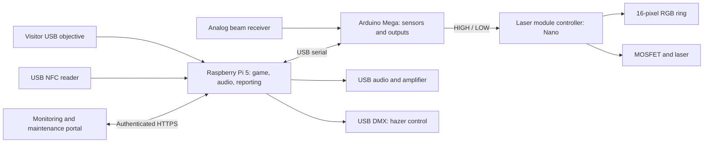

# ZoCo Laser Maze

A museum laser-maze system developed by Brent Richardson / ZoCo Exhibits.
The work combines physical interaction, lighting, audio, game logic, and remote
maintenance through a Raspberry Pi, Arduino Mega, and replaceable Nano-controlled
laser modules.

## Explore the work

- [Development timeline](docs/RELEASE-TIMELINE.md): 45 preserved release snapshots, October 13-November 7, 2026.
- [History provenance](HISTORY.md): how the archive dates and Git import dates are recorded.
- [Game controller](development/pi/panel_game.py), [game rules](development/pi/game_engine.py), and [audio](development/pi/game_audio.py).
- [Mega firmware](development/arduino/BenchController/BenchController.ino) and [laser module controller](development/arduino/LaserModuleNano/README.md).
- [Maintenance controls](development/maintenance/public/maintenance-lib.php) and [public fluid overview](development/fluid-overview/README.md).
- [Versioned deployment tooling](development/releases/README.md).



The prototype grew from an UNO R4 Minima bench test into a Mega-based controller,
with RFID and keypad entry, a USB objective, animated status lighting, receiver
calibration, reporting, and maintenance diagnostics. Historical snapshots include
experiments and superseded implementations; browse the current branch for the latest
source. Some portal feature folders are incremental patches, not standalone sites.

## Current verified milestone

`mega-module-pause-0.26.3` is the latest archived controller release. The two-second
maintenance module ON/OFF sequence was physically confirmed working. Remote commands
are allowlisted and actuator tests require local staff confirmation. DMX transmission
is implemented; physical hazer commissioning and full installation acceptance remain
separate tasks. Door-release hardware must operate independently of software.

## Run software checks

Use Python 3.11 or newer and a C++17 compiler for the firmware host tests. These tests
use simulated hardware and do not commission lasers, relays, or DMX equipment.

```sh
python3 -m pip install -r requirements-dev.txt
python3 -m unittest discover -s development/pi/tests -q
python3 -m unittest discover -s development/releases/tests -q
python3 -m unittest discover -s development/arduino/tests -q
```

No passwords, private keys, device credentials, visitor records, or live database
configuration are supplied. Machine addresses, hardware serial numbers and private
hosting paths are replaced with examples. Installation scripts require site-specific
review and configuration before use. The live exhibit is not deployed from this
public review copy automatically.

Development was directed, assembled and tested by Brent Richardson with AI-assisted
software implementation. This repository documents an ongoing physical exhibit
project, including unsuccessful iterations. Publication does not grant an additional
license to the source, audio, branding, or third-party dependencies.
